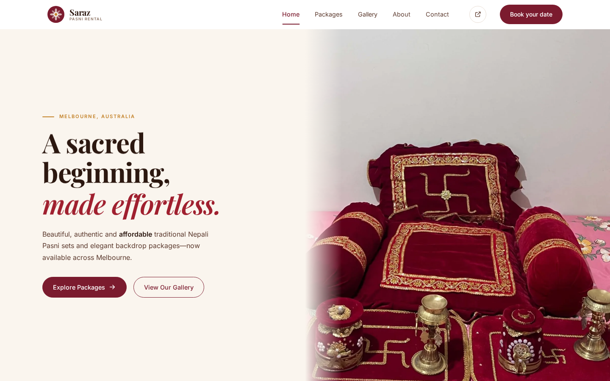
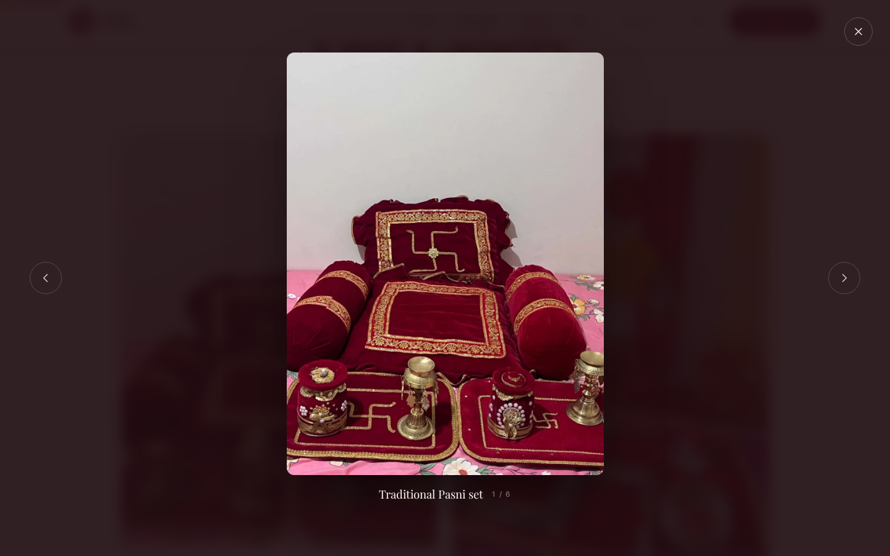
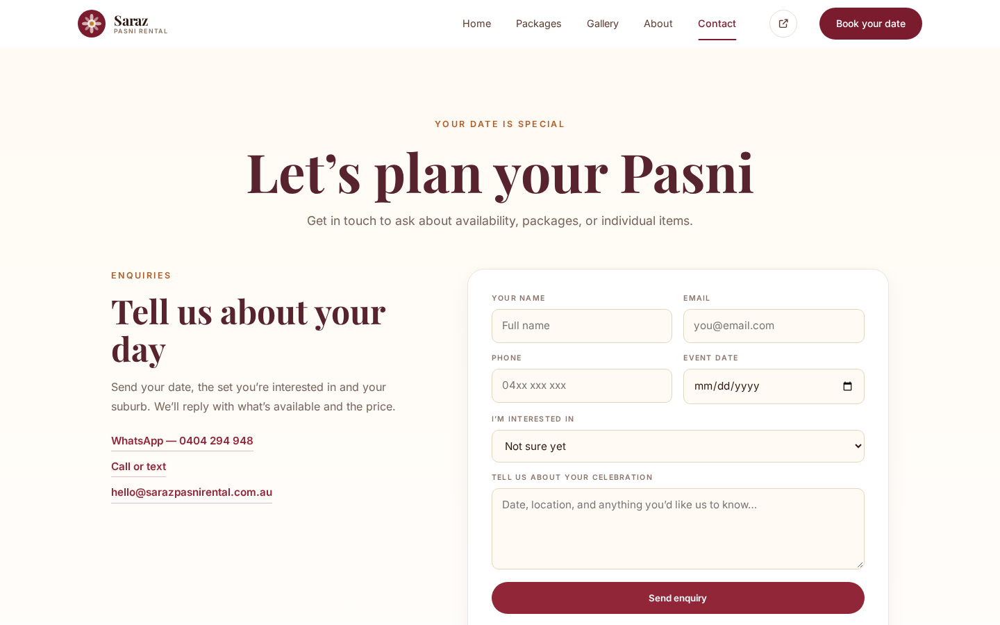

# Saraz Pasni Rental — website

Website for **Saraz Pasni Rental**, a Melbourne business renting traditional Nepali
Pasni sets, seating and backdrop decorations for rice-feeding ceremonies.

**Live site:** https://saraz-pasni-rental-v3.netlify.app



## What's in the site

- Five pages: Home, Packages, Gallery, About, Contact
- Traditional Pasni sets with the real item lists and prices
  (Basic $60, Standard $80, Full $100; backdrops $70 / $100; add-ons)
- Photo gallery with a full-screen lightbox (arrow keys / Esc supported)
- Booking enquiry form that opens the visitor's email app with the details filled in
- Real Google reviews (5.0 from 11 reviews) linked to Google
- Mobile-first responsive layout and a mobile menu
- Scroll choreography with GSAP ScrollTrigger:
  - hero headline reveals word by word
  - sections and cards animate into place as they enter the viewport
  - photography has a slow parallax drift and scale settle
  - thin reading-progress bar under the navigation
- Respects `prefers-reduced-motion`; all content is visible without animation
- Brand favicon / apple touch icon and WebP photography for faster loading

## Tech stack

- React 19
- Vite 8
- GSAP 3 (ScrollTrigger)
- Plain CSS (no UI framework)

## Getting started

```bash
npm install
npm run dev      # local development
npm run build    # production build in dist/
npm run preview  # preview the production build
npm run lint     # oxlint
```

Requires Node.js 20.19+ (or 22.12+).

## Project structure

```text
src/
  assets/            photography (WebP) and social icons
  components/        Navbar, Hero, sections, Lightbox, Footer
  pages/             Home, Packages, Gallery, About, Contact
  animations.js      GSAP ScrollTrigger choreography
  App.jsx            routing, scroll progress, animation setup
  index.css          design tokens and global styles
public/              favicon, apple touch icon, static icons
docs/screenshots/    screenshots used in this README
```

Routes are handled client-side in `src/App.jsx` from `window.location.pathname`
(`/`, `/packages`, `/gallery`, `/about`, `/contact`).

## Deployment

### Netlify

- Build command: `npm run build`
- Publish directory: `dist`
- SPA fallback: add a rewrite/redirect of `/*` to `/index.html` with status `200`
  (the live deployment uses a `_redirects` file with `/*  /index.html  200`)

### Docker

```bash
docker compose up --build -d   # serves the site at http://localhost:8080
```

The included `Dockerfile` builds the app with Node and serves `dist` through Nginx.

## Notes

- The enquiry form is intentionally front-end only: it composes a `mailto:` link to
  `hello@sarazpasnirental.com.au`. Change the address in
  `src/pages/ContactPage.jsx` if needed. If you later want submissions stored in a
  dashboard, connect it to Netlify Forms or a form backend.
- Photography is stored as WebP. The original JPEG files are not needed by the build.
- Fonts (Playfair Display, Inter) are loaded from Google Fonts.
- Website copy, photography and branding belong to Saraz Pasni Rental. No license is
  granted for reuse of the business content.

## Design versions

This repository contains the final version. Two design branches were explored during
development and kept live for comparison:

| Version | URL | Notes |
| --- | --- | --- |
| Original / comparison | https://saraz-pasni-rental.netlify.app | Original site design |
| Editorial redesign | https://saraz-pasni-rental-v2.netlify.app | Experimental different direction |
| Final (this repo) | https://saraz-pasni-rental-v3.netlify.app | Original design + scroll animation, lightbox, form |



